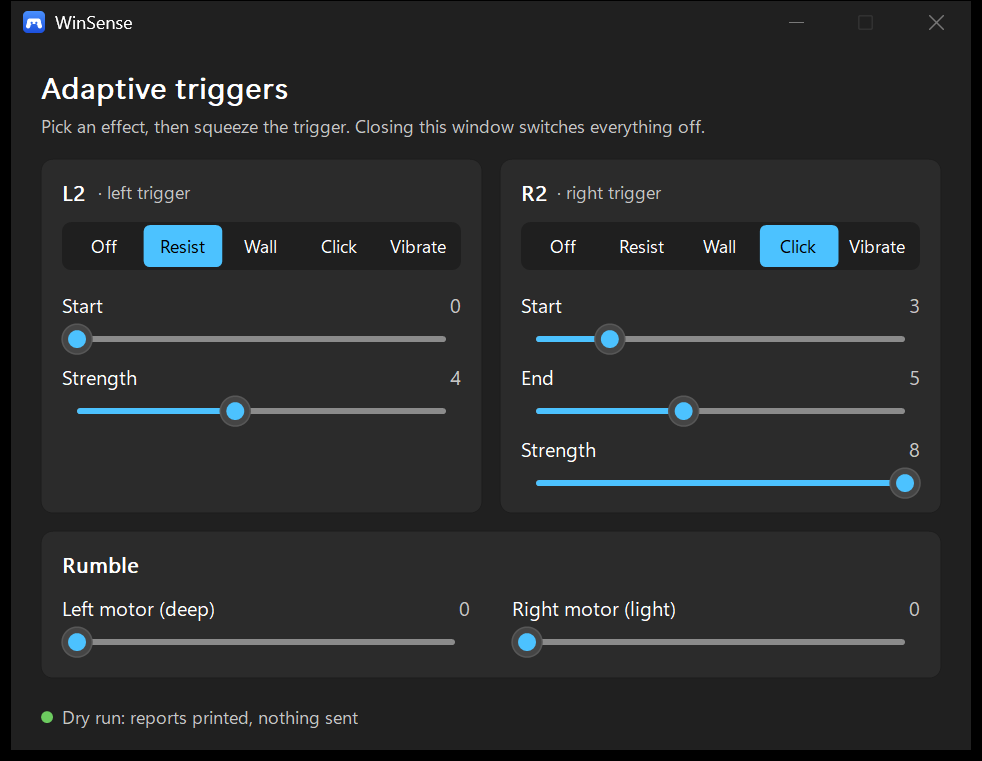

# WinSense

WinSense is a small Windows tray program for the PlayStation 5 DualSense controller. It gives the
controller's own features to the PC: adaptive triggers, rumble and real haptics, the lights, the
speaker and mic, the touchpad and gyro as a mouse, and a simple text port that game mods can use
to drive all of it.

It is one exe of about 1.5 MB. It needs no installer, no .NET, and no Visual C++ runtime.



## What it does

- **Adaptive triggers**: resistance, a wall, a gun-style click, or vibration on L2 and R2.
- **Rumble and haptics**: both rumble motors, and the real haptic actuators in the grips (over
  Bluetooth and on the cable).
- **Lights**: light bar colour, player lights, mute light.
- **Touchpad and gyro mouse**: move the Windows cursor with the touchpad or by tilting the
  controller.
- **Couch mode**: use the PC from the sofa with the sticks and buttons, with an on-screen
  keyboard.
- **Voice commands**: hold Mute and say "open Notepad", "volume up", "battery" and so on. This runs
  offline with Windows' own speech engine.
- **Battery**: charge in the tray menu, a warning when it is low, and an optional switch-off when
  idle.
- **Game sound as haptics**: the bass of whatever the PC plays, felt in the grips.
- **Mute light follows the PC mic**, and **buzz on notifications**.
- **Mod port**: a named pipe that takes one text line per game event, so a mod in any language can
  set triggers, rumble, haptics, lights and sounds. See [docs/modding.md](docs/modding.md).

Every feature that changes how the controller or the PC behaves starts switched off. You turn it
on from the tray menu.

## Install

1. Download `winsense.exe` from the [latest release](https://github.com/kiwiofspades/WinSense/releases/latest).
2. Put it in a folder of its own, for example `C:\Tools\WinSense\`. WinSense updates itself in
   that folder, so pick one you can write to (not `C:\Program Files`).
3. Double-click it. The icon appears in the tray (you may need the `^` arrow next to the clock).

**SmartScreen**: the exe is not code-signed, so Windows may say "Windows protected your PC" the
first time. Click **More info**, then **Run anyway**. Each release lists the file's SHA-256, so
you can check that your download matches.

**Start with Windows**: tick it in the tray menu if you want WinSense to start when you log on.

## First run

1. Pair the DualSense with Windows (Settings > Bluetooth & devices > Add device, while holding
   Create and PS until the light flashes), or plug it in with a USB-C cable.
2. Start WinSense. The tray menu's first line says whether a controller is connected.
3. Open **Trigger test screen** from the tray menu, pick an effect and squeeze the trigger.
   Closing that window switches every effect off again.
4. Hold your finger still on the touchpad for about half a second to turn the touchpad mouse on.

The [user guide](docs/guide.md) explains every menu item, button and voice command.

## What else you might need

- **Nothing else**, for everything above.
- **ViGEmBus**, only for the optional virtual Xbox 360 pad (`winsense ui --pad`). Most players do
  not need it: games that know the DualSense, Steam, and the features above all use the real
  controller. ViGEmBus is retired but still works; its last setup is version 1.22.0.

## One thing to know about Bluetooth

When the controller first connects over Bluetooth it sends a short report that every program
understands. The adaptive triggers, lights, haptics and gyro need the long report, and the
controller switches to it on the first request it gets. After that, programs that only read the
short report (some browser gamepad testers, DirectInput games) stop seeing the controller until
you turn it off and on again. Steam and games that support the DualSense are not affected.
WinSense waits to switch until you use one of those features.

## Updates

WinSense checks GitHub for a new release when it starts and at most once a day after that. When
one is out, a balloon tells you. Nothing is downloaded until you say yes. The download is checked
against the SHA-256 published with the release, then WinSense swaps in the new exe and restarts.
You can also use **Check for updates** in the tray menu.

## Build from source

You need Rust (stable, MSVC toolchain) on Windows 10 or 11.

```
cargo build --release
cargo test
```

The exe is `target\release\winsense.exe`. `winsense help` lists the command-line test commands.

## Licence

MIT, see [LICENSE](LICENSE). Credits for the open projects this builds on are in
[CREDITS.md](CREDITS.md).

WinSense is not made by or connected with Sony. DualSense and PlayStation are trademarks of
Sony Interactive Entertainment.
