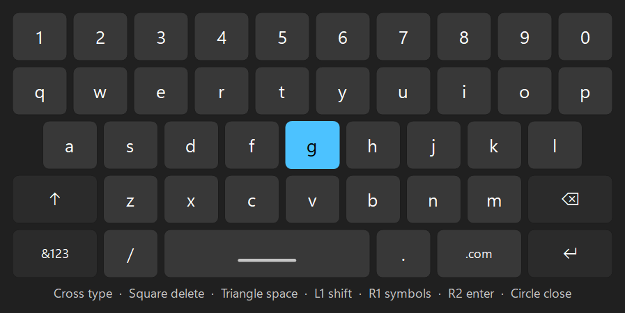

# WinSense user guide

WinSense runs in the tray. Click its icon (left or right button) to open the menu. This guide goes
through the menu from top to bottom, then the controller's buttons, voice commands and the test
commands.

Everything that changes how the controller or the PC behaves starts **off**. WinSense remembers
what you tick (per Windows user, under `HKEY_CURRENT_USER\Software\WinSense`).

## The tray menu

### Status lines

The first grey line says whether a DualSense is connected and whether the touchpad or gyro mouse
is on. The second shows the battery, for example "Battery 85%" or "Battery 35%, charging". Hover
over the icon to see the same two lines.

Over Bluetooth the battery only shows once the controller sends its long report (see "Bluetooth
and the long report" below). Until then the line says "Battery shows after you hold the touchpad
down". On the cable it always shows.

When the charge falls to about 25% while on battery, a balloon says so once. It warns again only
after the controller has been charging.

### Trigger test screen

A window for trying the triggers and rumble by hand. For each trigger pick Off, Resist, Wall,
Click or Vibrate, then set where the effect starts and how strong it is. The Rumble row has one
slider per motor: the left one is deep, the right one is light.

Nothing is sent until you change a control. Closing the window switches both triggers and the
rumble off. The window follows Windows' dark or light mode and accent colour, and works with the
keyboard (Tab, arrow keys, Page Up and Page Down, Home and End).

What each effect feels like:

| Effect | What you feel |
|---|---|
| Resist | Steady resistance from the start point to the end of the pull. |
| Wall | A firm stop at the start point. You can push past it with some force; no setting makes a hard lock. |
| Click | Resistance that gives way suddenly, like a gun trigger. |
| Vibrate | The trigger buzzes while you hold it past the start point. Pull it well in to feel it. |

Trigger effects stay on the controller after a program ends unless something switches them off.
WinSense switches off whatever it set when you close the screen or quit.

### Touchpad mouse

Ticks or unticks the touchpad mouse. You can also switch it with the controller: hold a finger
still on the touchpad for about half a second. A chime from the controller's speaker confirms it
(over Bluetooth).

While it is on:

- Slide a finger to move the cursor.
- Click the touchpad for a left click; click with two fingers down for a right click.
- R2 is a left click and L2 a right click while a finger rests on the pad.

### Gyro mouse

Tilt the controller to move the cursor. Switch it with the menu, or hold **Create** and click the
touchpad. While it is on, R2 is a left click and L2 a right click.

WinSense learns the gyro's resting point slowly while the controller lies still, so the cursor
does not drift. Windows' pointer speed setting applies to both mouse modes.

### Couch mode

For using the PC from the sofa with the controller alone:

| Control | Does |
|---|---|
| Left stick | Moves the cursor (faster the further you push) |
| Right stick | Scrolls, up and down and sideways |
| R2 / L2 | Left click / right click (hold to drag) |
| D-pad | Arrow keys (they repeat when held) |
| Cross | Enter |
| Circle | Escape |
| Square | Opens the on-screen keyboard |
| Triangle | Task View (pick a window with the d-pad and Cross) |
| L1 / R1 | Back / forward in a browser |
| Options | The Start menu |

Couch mode keeps out of games by itself. It goes quiet while a fullscreen program that is not the
Windows shell or a browser is in front, and whenever the program in front lives in a game folder
(Steam, Epic, GOG, Xbox, or folders named `Emulation` or `roms`). For a windowed game it cannot
detect, hold **Create** alone for one second to pause couch mode. Do the same to start it again.

It works over Bluetooth without switching the controller to the long report, so other programs
keep seeing the controller as before.

#### The on-screen keyboard

Square opens it at the bottom of the screen. It does not take the focus, so the text goes into
the box you were in.

| Control | Does |
|---|---|
| D-pad or left stick | Moves the highlight |
| Cross | Types the highlighted key |
| Square | Backspace |
| Triangle | Space |
| L1 | Shift for one letter |
| R1 | Symbols on or off |
| Options or R2 | Enter (and closes the keyboard) |
| Circle | Closes the keyboard |

The keyboard does not open by itself when you click into a text box; press Square.

### Game sound as haptics

Plays the bass and the tune (20 to 800 Hz) of whatever Windows is playing in the controller's
grips, so you feel explosions, bass and music. Loud parts feel stronger than quiet ones, and it
keeps going through short pauses in the sound. It needs the controller on Bluetooth. It stays quiet while anything
drives the rumble motors (rumble wins), while you speak a voice command, and when the PC's sound
plays through the controller itself.

While it is ticked, WinSense may show up in Windows' volume mixer. It only listens; it plays
nothing there.

### Mute light follows PC mic

The controller's orange mute light shows whether your PC microphone is muted. It follows the
Windows mute of your default recording device. Some USB mics have their own mute button that
Windows never hears about; WinSense also counts the mic as muted when it is exactly silent for
1.5 seconds while an app is recording from it.

### Buzz on notifications

Two short taps in the grips when Windows shows a new notification, at most one buzz every three
seconds. It does not buzz while a game is in front (the same test as couch mode), while you speak
a voice command, or, over Bluetooth, before the controller is on the long report. Apps that do not
send Windows notifications (for example Discord with its notifications off) cannot make it buzz.
It also buzzes while Windows' do-not-disturb hides the banners.

### Turn controller off

Disconnects a Bluetooth controller, which then turns itself off. Press PS to turn it on again.
No administrator rights are needed.

### Turn off when idle (10 minutes)

Turns a Bluetooth controller off after 10 minutes without input. Input means a button, a stick or
trigger moved, a finger on the touchpad, or the controller being moved. A mod sending effects, an
effect left on in the test screen, or game sound being played in the grips also count as use. A
controller on the cable is left on.

### Start with Windows

Starts WinSense when you log on (a per-user Run entry; no administrator rights).

### Check for updates

Asks GitHub whether a newer release is out. WinSense also does this when it starts and at most
once a day. When there is one, it asks you first. Only after you say yes does it download the new
exe, check it against the SHA-256 published with the release, put it in place of the old one and
restart. If anything goes wrong, the old exe stays as it was.

### Quit

Closes the test screen, switches off any trigger effect, rumble and light WinSense set, closes
the mic if it is open, and ends the program.

## Cable and Bluetooth together

If you plug in a controller that is also connected by Bluetooth, WinSense drops the Bluetooth link
so the controller runs on the cable alone. A balloon says so. Without that, the haptics do not
work on the cable. When you unplug it, the controller turns off; press PS to reconnect over
Bluetooth.

## Bluetooth and the long report

Over Bluetooth the controller starts with a short report that most programs can read. Triggers,
lights, haptics, battery, gyro and the touchpad position need the long report, and the controller
switches to it when a program asks for it. It then stays on the long report until it is turned
off. Programs that only understand the short report (some browser testers, DirectInput games)
then stop seeing the controller.

WinSense does not switch on its own. The switch happens when you turn on the touchpad or gyro
mouse, open the test screen, or when a mod or a feature sends something to the controller.

## Voice commands

Voice works over Bluetooth only, because the mic audio arrives in the controller's own reports.
Hold **Mute** for about half a second. A chime plays, then the mic opens. Say the command while
you keep holding Mute (up to 8 seconds), then let go. WinSense answers through the controller's
speaker. Recognition runs on the PC with Windows' own speech engine; nothing is sent anywhere.

You can start with a name or leave it out: "computer", "jarvis", "yo", "hey" or "okay". So
"Open Notepad" and "Computer, open Notepad" both work.

| Say | Does |
|---|---|
| open, focus, switch to, close + an app's name | Opens it, brings its window to the front, or closes it. The names are the apps in your Start menu. Close asks the app to close, so it may still ask about unsaved work. |
| go to my downloads / documents / desktop / pictures / music / videos (folder) | Opens that folder in Explorer |
| volume up, louder / volume down, quieter | Changes the volume by a tenth |
| mute, unmute | Mutes or unmutes the PC's sound |
| pause, play | Presses play/pause |
| next, skip / previous | Next or previous track |
| battery, what's my battery, how much battery | Says roughly how full the battery is |
| turn off controller, controller off | Turns the controller off |
| mouse on/off, turn on/off mouse, touchpad on/off | Switches the touchpad mouse |
| gyro on/off, turn on/off gyro | Switches the gyro mouse |

Only apps from the Start menu can be opened, and some are never offered: command prompts,
PowerShell, system tools, installers, uninstallers and scripts.

The one-word commands ("next", "play", "mute") can be set off by a word that sounds alike. What
they do is small and easy to undo.

**Steam and voice**: Steam reads the controller too, and it mistakes the mic audio for button
presses. So while the mic is open WinSense pauses Steam and lets it run again right after. If
Steam cannot be paused, voice refuses and a balloon says why. Other programs that read the
controller through SDL (some emulators) may react the same way.

## Sounds from the controller

The chimes for the switches and the voice replies come from the controller's own speaker, over
Bluetooth only. Mods can play a few built-in sounds too (see [modding.md](modding.md)).

## Test commands

`winsense.exe` also takes commands, for testing from a terminal. Run `winsense help` for the full
list. The ones that write to the controller refuse while the tray runs.

| Command | Does |
|---|---|
| `winsense look 10` | Lists DualSense controllers and prints their input for 10 seconds. Sends nothing. |
| `winsense ui` | The trigger test screen on its own. `--pad` also plugs in a virtual Xbox 360 pad (needs ViGEmBus). |
| `winsense trigger r2 resist 3 8` | Sets one trigger effect. End with `winsense trigger both off`. |
| `winsense rumble 200 0 1000` | Rumbles the left motor for one second. |
| `winsense haptic left 80 50 1500` | An 80 Hz tone at half strength in the left grip for 1.5 seconds. |
| `winsense light 0 0 255` | A blue light bar. `winsense light off` gives the lights back. |

PowerShell and Command Prompt do not wait for a Windows program to finish, so the prompt may come
back before the output. Add `| more` to wait.
